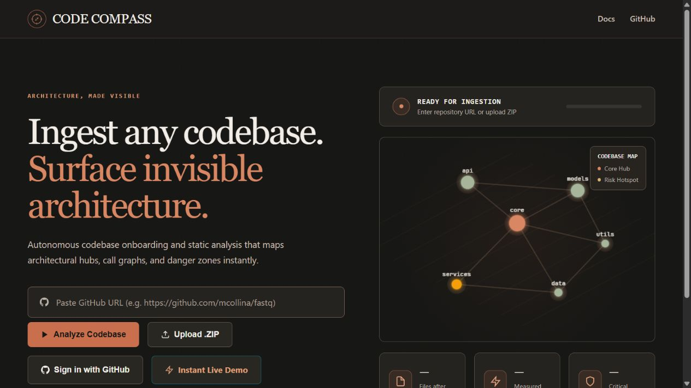
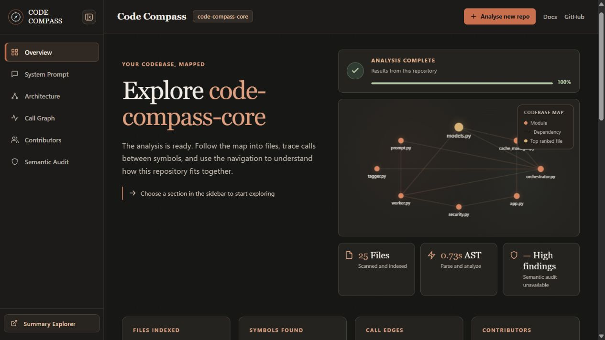
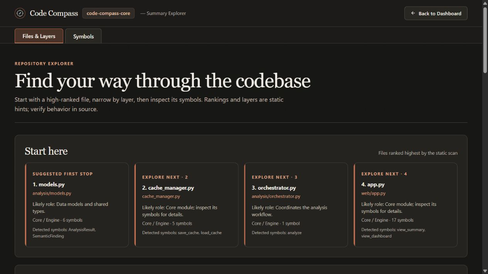
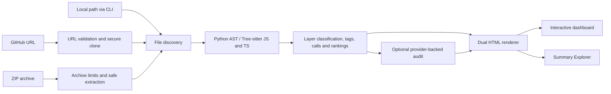

# 🧭 Code Compass

**Architecture, Made Visible — Autonomous Codebase Onboarding & Static Analysis Engine**

[](pyproject.toml)
[](src/code_compass/web/app.py)
[](src/code_compass/analysis/js_analyzer.py)
[](pyproject.toml)


Code Compass turns an unfamiliar repository into a navigable picture of how it is built. Give it a GitHub URL, a ZIP archive, or a local path through the CLI, and it discovers source files, extracts symbols and static calls, classifies architectural layers, and highlights the files most useful to read first.

The result is a self-contained HTML dashboard and a companion Summary Explorer: an expandable architecture map, caller-to-callee views, contributor history, code health signals, and a repository-specific AI system prompt. An optional provider-backed audit can review selected source excerpts for concrete security and correctness findings. Code Compass is designed to shorten the distance from “I just opened this repo” to “I know where to start.”

<details>
<summary><strong>See the landing page, dashboard, and Summary Explorer</strong></summary>







</details>

## Contents

- [What it can do](#what-it-can-do)
- [How it works](#how-it-works)
- [Install and run](#install-and-run)
- [Use the browser app](#use-the-browser-app)
- [Read the results](#read-the-results)
- [Configuration](#configuration)
- [Accuracy and limits](#accuracy-and-limits)
- [Development](#development)
- [License](#license)

## What it can do

| Capability | What you get |
| --- | --- |
| **Multi-language AST analysis** | Python symbols and McCabe cyclomatic complexity via the standard-library `ast`; JavaScript and TypeScript symbols and calls via Tree-sitter. |
| **Architectural layering** | Files and symbols organized into 10 inferred tiers: Core/Engine, API/Routes, Models, Services, Middleware/Auth, UI, CLI, Infra, Utilities, and Tests. Tags and file rankings help prioritize reading. |
| **Interactive call graph** | Static caller-to-callee relationships grouped by source file, with repeated calls aggregated. Unresolved callee locations are labelled rather than guessed. |
| **Architecture map and Mermaid source** | A dark, expandable SVG mind map of real repository layers, files, and symbols. Drag to pan, scroll to zoom, focus a branch, fit the full map, export SVG, or copy the generated Mermaid architecture description. |
| **Git and contributor analytics** | Up to 100 contributors, commit shares, verified GitHub profile links and avatars when available, and addition/deletion totals from GitHub statistics or complete local history. Missing line totals are shown as unavailable. |
| **Code health signals** | Python cyclomatic complexity, a heuristic health score, ranked files, and opt-in dead-code candidates. The modularity index is displayed as **Not measured** because no modularity metric is calculated yet. |
| **Semantic and security audit** | After analysis, connect a user-chosen OpenAI-compatible HTTPS chat-completions endpoint, model, and API key to review bounded excerpts from up to 12 ranked source files. |
| **AI system prompt** | A one-click, repository-specific brief with indexed paths, inferred structure, and static call hints for an AI coding assistant. |
| **Summary Explorer** | A companion `*-summary.html` page with folder and file grouping, layer and kind filters, search, sorting, pagination, symbol focus, and direct GitHub source links when a repository commit is known. |
| **Defensive web ingestion** | Session-scoped results, in-memory rate limits, double-submit CSRF validation, Content Security Policy headers, bounded ZIP extraction, and path-traversal checks. |

## How it works



The analysis is static: Code Compass parses source files and Git history; it does not run the analyzed application. The browser app uses FastAPI, while the CLI uses the same discovery, analysis, and rendering pipeline for local folders.

## Install and run

**Prerequisites:** Python **3.11 or newer** and Git. Install [uv](https://docs.astral.sh/uv/) if you want the recommended setup path.

```bash
git clone https://github.com/Gracy769/code-compass-app.git
cd code-compass-app
```

### Option A — uv (recommended)

```bash
uv sync --extra test
uv run code-compass analyze .
uv run code-compass serve --host 127.0.0.1 --port 8000
```

The first analysis writes `compass-dashboard.html` and `compass-dashboard-summary.html` in the current directory. Open the dashboard in a browser. The last command starts the web app at **http://127.0.0.1:8000**; run it separately when you want browser-based ingestion.

### Option B — standard Python and pip

```bash
python -m venv .venv

# macOS / Linux
source .venv/bin/activate

# Windows PowerShell: .venv\Scripts\Activate.ps1
# Windows Command Prompt: .venv\Scripts\activate.bat

python -m pip install --upgrade pip
python -m pip install -e ".[test]"
code-compass analyze .
code-compass serve --host 127.0.0.1 --port 8000
```

Activate the virtual environment with the command for your operating system, then continue with installation. The `test` extra installs the test tools; use `python -m pip install -e .` if you only need the application.

### Analyze a different local repository

```bash
code-compass analyze /path/to/repository --output reports/architecture.html
code-compass analyze /path/to/repository --strict
```

| CLI option | Behavior |
| --- | --- |
| `--output PATH` | Write the dashboard at `PATH` and the Summary Explorer beside it with `-summary` before `.html`. |
| `--strict` | Enable dead-code candidate detection. Public APIs and dynamically called code can produce false positives. |
| `--semantic` | Reserved in the CLI; it does **not** run a provider-backed audit. Configure the audit in the web dashboard instead. |

## Use the browser app

1. Start the server with `code-compass serve --host 127.0.0.1 --port 8000` and open **http://127.0.0.1:8000**.
2. Paste a `https://github.com/owner/repo` URL, upload a ZIP, or open the instant live demo. For a private GitHub repository, choose **Sign in with GitHub**, authorize repository access, and select a repository. You can switch GitHub accounts in the repository picker. A personal access token is available as a fallback.
3. Wait for the completion check, then move through **Overview**, **System Prompt**, **Architecture**, **Call Graph**, **Contributors**, and **Semantic Audit**. Open **Summary Explorer** for the file and symbol indexes.
4. Choose **Analyse new repo** to return to ingestion without confusing the finished analysis with a new one.

The browser accepts GitHub repository URLs and ZIP uploads; it cannot read an arbitrary local folder path. Use the CLI for a folder already on your machine. A plain ZIP has no contributor history; a ZIP containing an initialized `.git` directory can show its real commit history.

### Run a semantic audit

Open **Semantic Audit** after analysis and enter a public HTTPS OpenAI-compatible `/chat/completions` endpoint, a model ID, and an API key. Code Compass sends bounded excerpts from **up to 12 ranked source files** to that endpoint and validates the returned findings against the sent paths. The key is used for that request and is not saved with the analysis. Review every finding against the source; an empty result is not a security guarantee.

## Read the results

| View | Best used for |
| --- | --- |
| **Overview** | Repository snapshot, file and symbol counts, top-ranked files, health indicators, and a small architecture preview. |
| **Architecture** | Explore a layer → file → symbol mind map. Expand and collapse nodes, pan and zoom, focus a branch, fit all, copy Mermaid source, or export SVG. This structural hierarchy is separate from call relationships. |
| **Call Graph** | Follow static caller and callee relationships, grouped by source file. Calls are hints from syntax, not proof of a runtime path. |
| **Contributors** | Inspect real GitHub/API or Git-history contributors, commit share, profile links, and line totals where the source provides them. |
| **Semantic Audit** | Configure a provider and inspect validated findings, audit status, and errors. |
| **System Prompt** | Copy a bounded, repository-specific starting context for an AI assistant; verify its inferred claims against code. |
| **Summary Explorer** | Search, group, filter, sort, and inspect ranked files and extracted symbols. GitHub code links use the analyzed commit when available. |

The two HTML pages should stay together because the dashboard links to its companion summary. Their analysis data, styles, and interactive map code are embedded in the generated files.

## Configuration

Core local analysis needs no API key or database. These settings are optional for a hosted instance:

| Setting | Purpose |
| --- | --- |
| `SUPABASE_URL` + `SUPABASE_SERVICE_KEY` | Enable seven-day analysis caching using the `analysis_cache` table in [`src/code_compass/schema.sql`](src/code_compass/schema.sql). Set `SUPABASE_SERVICE_KEY` to a server-only Supabase secret key (or legacy service-role key). Run the schema SQL once in Supabase SQL Editor; the file is not applied automatically. Browser GitHub cache hits check the requester's GitHub access before serving private analyses. |
| `SUPABASE_ANON_KEY` | Enables browser-side Supabase GitHub sign-in when paired with `SUPABASE_URL` and a configured GitHub OAuth provider. Add `https://YOUR_HOST/auth/callback` to Supabase's allowed redirect URLs. |
| `HOST` + `PORT` | Bind address and port for [`server.py`](server.py), including the supplied Docker/Railway launcher. The `code-compass serve` command uses its `--host` and `--port` flags instead. |

GitHub credentials entered in the browser are sent with the analysis request for cloning and GitHub API access. Audit credentials are supplied separately when an audit is run. Keep a hosted service behind HTTPS and configure your Supabase and GitHub OAuth settings for its public origin. GitHub OAuth's `repo` scope grants broad repository access, including write permission; it cannot limit access to selected repositories. Repository-level installation choices require a GitHub App integration.

## Accuracy and limits

- **Static evidence, not runtime tracing.** Calls, layers, rankings, the health score, and generated AI context are inferred from source. Check important conclusions against the repository.
- **Language scope.** Python, JavaScript, and TypeScript are parsed for symbols and calls. McCabe complexity is calculated for Python functions; JS/TS symbols currently carry a baseline complexity value rather than equivalent measured complexity.
- **Contributor sources.** GitHub's contributor endpoints may be delayed or unavailable. The app falls back to complete local Git history when possible and shows a dash when trustworthy line totals are unavailable. Plain folder ZIPs show no contributors.
- **Audit scope.** The provider sees excerpts from up to 12 ranked files, capped per file and overall. It is opt-in and cannot establish that a repository is secure.
- **Ingestion bounds.** The web app accepts ZIPs up to 25 MB, limits extracted content to 200 MB and 10,000 entries, and gives Git analysis a 120-second deadline. Large or binary files may be indexed without heavy parsing.
- **Security boundary.** Rate limits are in memory and reset on process restart. Session-scoped results expire; the bundled demo remains public. The Content Security Policy permits inline assets needed by the self-contained pages.

## Development

```bash
uv sync --extra test
uv run pytest -q
```

With the pip setup, run `python -m pytest -q`. From an uninstalled checkout, set `PYTHONPATH=src` first.

```text
src/code_compass/
├── analysis/        # AST parsing, classification, contributors, prompts, audits
├── web/             # FastAPI ingestion, worker, and input security
├── templates/       # Self-contained dashboard, mind map, and summary views
├── cli.py           # analyze and serve commands
├── discovery.py     # repository file discovery
├── renderer.py      # dual HTML output
└── cache_manager.py # optional Supabase cache
tests/               # analysis, rendering, web, and security checks
```

For a container deployment, the included [`Dockerfile`](Dockerfile) starts [`server.py`](server.py), which reads `HOST` and `PORT` from the environment. The [`railway.json`](railway.json) file selects that Docker build.

## License

The project metadata declares the **MIT License** in [`pyproject.toml`](pyproject.toml). Code Compass is an active hackathon build; contributions and issue reports are welcome through [GitHub](https://github.com/Gracy769/code-compass-app).
