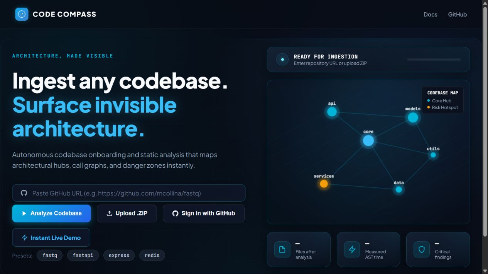
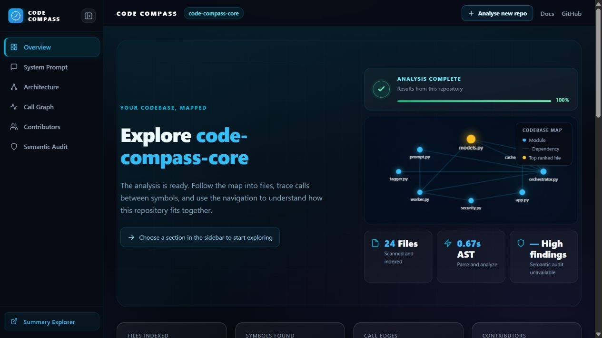
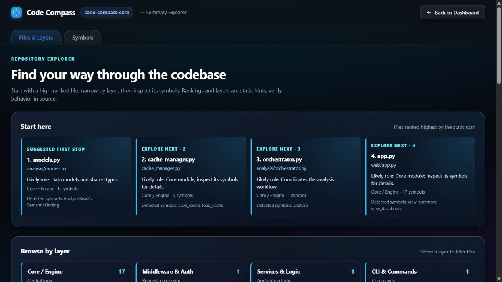

# Editorial UI comparison

These screenshots were captured at a 1280 px desktop viewport from the live demo on the same `master` baseline and this branch. The demo scans the running checkout, so the redesigned views include the new theme template as one additional indexed file. The layout and palette are the intended comparison.

| View | Before | After |
| --- | --- | --- |
| Landing |  |  |
| Overview |  |  |
| Summary Explorer |  |  |

The architecture tree, call graph, contributor table, audit form, and AI context share the same inlined theme. Their data and interactions remain in the existing templates and scripts.
